import YouTubeTranslated from '@site/components/YouTubeTranslated';
import { Quote } from '@site/components/Quote';

# View Transitions in Depth: How to Finally Start Using Them

We've all seen those magical View Transitions demos.
Yet they are still used so little.
I know ... All those pseudo-elements sound scary.
I'll show you there is nothing to be afraid of.
First a three-step tutorial on the fundamentals.
Then two chapters of practical tips and tricks beyond them.

{/* truncate */}

One note before we start. This article is not for people who say: "I will just vibe code it."
I think that, at least today, it is still good to know how the technology I use works.
So I can communicate with the agent, understand it, and debug problems when they come.

This article is basically a transcript of my talk at FrontKon 2026 in Prague.
If you prefer a video, here it is.
The talk is in Czech with English subtitles.

<YouTubeTranslated
  videoId="93h-f9AzUoI"
  title="View Transitions in Depth: How to Finally Start Using Them (FrontKon 2026)"
/>


<br/><br/><br/><br/>

<hr/>


## Why animate?

I have an app called Artificial Atlas. It shows AI models as a list of cards.
A user can click on a card and get to the detail of the model.
There is a description, data, charts, statistics. A lot of information.
It is overwhelming. And the user might be confused by all the elements changing on the page.

Now let me add an animation.
The card gradually opens into the detail. And after clicking back, it closes and lines up among the others again.
Animations are not just for beauty.
They are a very practical tool.
They direct the user's attention, guide the user through our app, and help them with orientation.

<div className="[&_img]:rounded-xl">
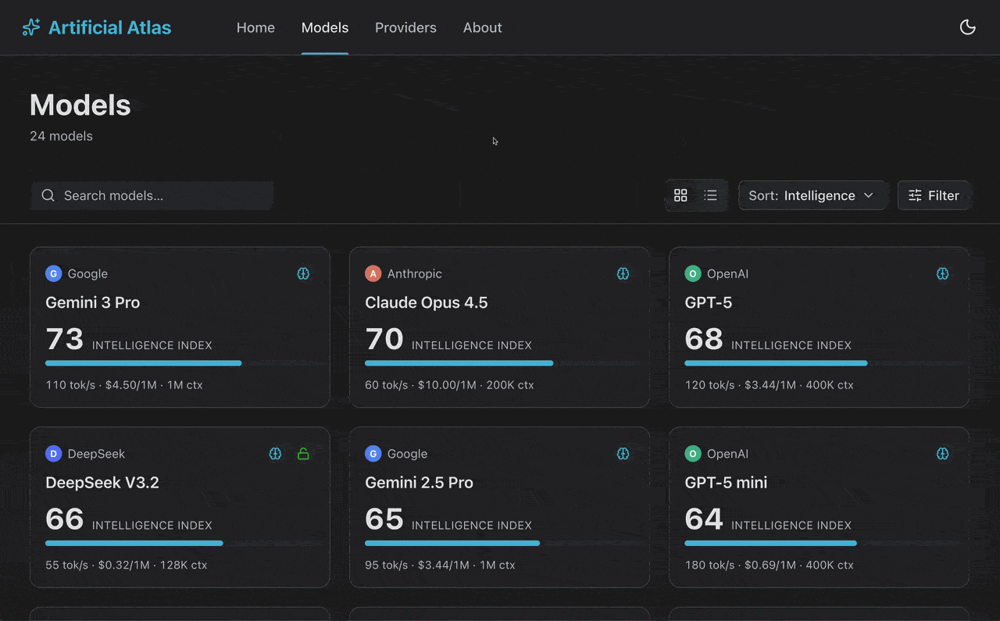
</div>


<br/><br/><br/><br/>

<hr/>


## Fundamentals

I will show the fundamentals on an example. Let's take this simple animation of switching tabs.
To keep it really simple, we will animate just the tab indicator. The one which moves from left to right.

<div className="mx-auto md:w-1/2 [&_img]:rounded-xl">
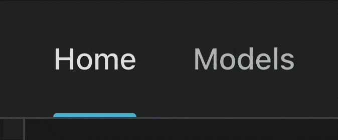
</div>

There are three steps you have to do to use View Transitions.

1. Enable them.
1. Select the elements you want to animate.
1. Customize the animation so it looks the way you need.

Thanks to [Bramus Van Damme](https://www.bram.us/), who inspired me to structure the tutorial into these three steps.


<br/><br/>

<hr/>


### 1. Enable View Transitions

What is unique about View Transitions is that they work not only in single-page applications,
like most JavaScript libraries, but in multi-page applications too.

<br/>

#### MPA

<div className="[&_img]:rounded-xl">
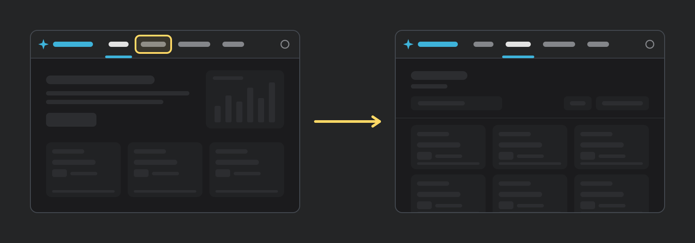
</div>

In a multi-page app, the server returns an HTML page and the browser displays it.
When I click a link, the browser downloads a second page.
So I have two pages, two HTML documents, and I want to animate between them.

To enable View Transitions between those two pages,
I add this piece of code to the CSS of both the first and the second page.

```css title="MPA"
@view-transition {
  navigation: auto;
}
```

That's all. View Transitions are enabled.

<br/>

#### SPA

<div className="[&_img]:rounded-xl">
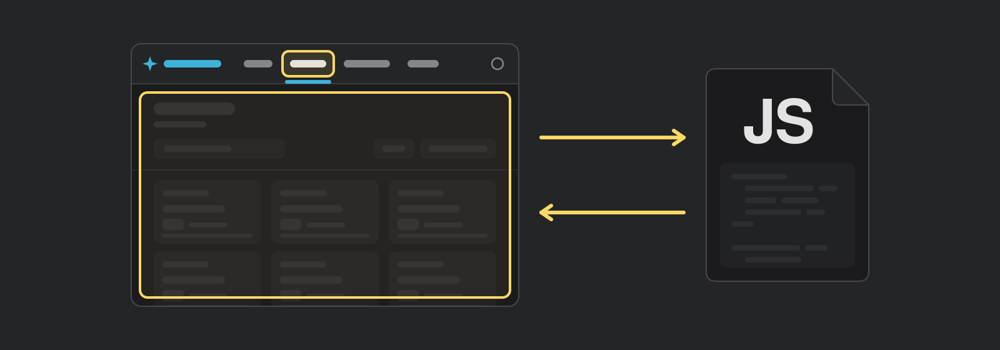
</div>

A single-page app works a little differently. I have one HTML file. One page.
When I click a link, JavaScript runs and updates the content of the page.

It means that somewhere in my JavaScript there is a function which (in the end) updates the DOM.
It can be a state setter in the case of React. Imagine something like `setPage("/models")`.

Before this function is called, the page is in some state. After the call, it is in another state.
And I want to animate between them.
To enable View Transitions, I wrap the function call into `startViewTransition`.

```ts title="SPA"
// highlight-next-line
document.startViewTransition(() => {
  setPage("/models");
// highlight-next-line
});
```

<div className="text-[color:var(--ifm-color-emphasis-400)]">

Advanced React note: The setter must be wrapped in `flushSync`, so the DOM is updated right away.

</div>

<br/>

#### Default animation

Just two lines of code, in either MPA or SPA, and I already see View Transitions working. The so-called default animation.
It is a crossfade.

<div className="mx-auto md:w-1/2 [&_img]:rounded-xl">
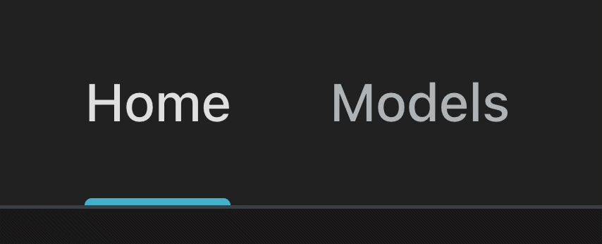
</div>

It does not happen on this element only.
It happens on the whole page. That is the default.


<br/><br/>

<hr/>


### 2. Select elements to transition

I do not want a crossfade. I want the tab indicator to move from left to right.

When selecting elements, it is good to imagine the state before and the state after.
If you have time, take two screenshots and put them next to each other.
Or at least visualize it in your head.

<div className="grid grid-cols-2 gap-4 text-center [&_img]:rounded-xl">
<div>

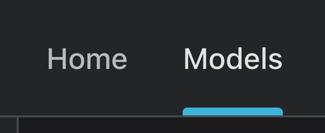

BEFORE

</div>
<div>

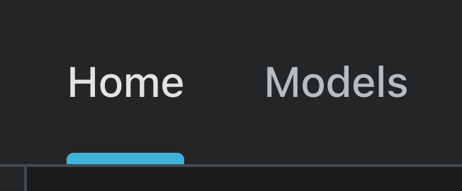

AFTER

</div>
</div>

Here it is simple. The element is the tab indicator.
In my HTML it looks roughly like this. Some `div` with a class name.

```html
<div class="tab-indicator">
```

If I want to select the element, so I can work with it in a view transition, I have to name it.
I do it in CSS.

```css
.tab-indicator {
  /* highlight-next-line */
  view-transition-name: tab-indicator;
}
```

The name does not have to be the same as the class. I can pick whatever I want.
But in this case it makes sense to call it `tab-indicator` too.
So another two lines of code, and my tab indicator is moving.
Its position is animated from left to right.

<div className="mx-auto md:w-1/2 [&_img]:rounded-xl">
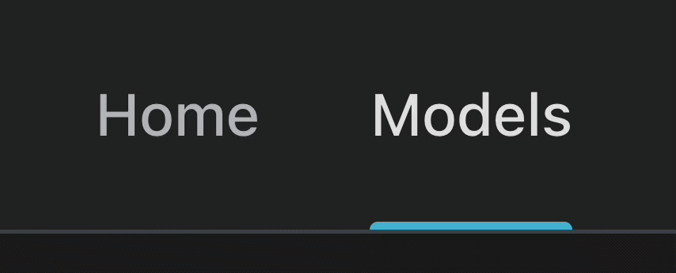
</div>

<br/>

#### Named element, group, captured element

A little detour to terminology. By giving the element a `view-transition-name`, we have created a *named element*.
You will also see it called a *view transition group* or a *captured element*, because the browser captures its state before and after.

<Quote variant="banner" className="mx-auto w-fit text-center">Named element <span className="text-[#ffd966]">=</span> Group <span className="text-[#ffd966]">=</span> Captured element</Quote>

So when you see any of these somewhere, or when you talk to your agent, they all refer to the same entity.

<br/>

#### Pseudo-element tree

When you look into the Elements tab of your browser DevTools while the transition is running,
you will see that the browser adds a pseudo-element tree like this one to the top.

```html
<html>
  ▼ ::view-transition
    ▶ ::view-transition-group(root)
    <!-- highlight-start -->
    ▼ ::view-transition-group(tab-indicator)
        ::view-transition-old(tab-indicator)
        ::view-transition-new(tab-indicator)
    <!-- highlight-end -->
  <head>...</head>
</html>
```

It contains two view transition groups. Those are our named elements.
The first one is the default one, `root`. It is there from the beginning and it is the one doing the crossfade.
The second one is our tab indicator. As soon as I name an element, it is added here.
And it has `old` and `new` pseudo-elements inside.
That is the old captured state and the new captured state. The animation runs between them.

<div className="text-[color:var(--ifm-color-emphasis-400)]">

I left out the `::view-transition-image-pair` level for simplicity.

</div>

<br/>

#### FLIP

Have you ever heard of the FLIP animation technique?
It is an acronym. First, Last, Invert, Play.
I like it a lot because it describes exactly how view transition animations work.

- **First.** The state before is rendered and captured.
- **Last.** The state after is rendered off the user's screen. And captured too.
- **Invert.** We go back to the first state and the animation is calculated.
- **Play.** The animation is played.

It is also the reason why View Transitions are so performant.
To simplify, they animate just screenshots of those two states. They do not animate elements.
So the animation is very easy for the browser to calculate.
In many cases it can run on the browser's compositor thread, off the main thread.

And that is exactly what the pseudo-element tree shows.
Old and new. First and last. And an animation between them.


<br/><br/>

<hr/>


### 3. Customize animations

So far the animation uses the default `ease` timing function.
But I like physics-based animations. They are modern today.
Various spring effects, working with the weight of objects.
So I would like to add a spring effect here.

Right in CSS I can refer to the created pseudo-element `::view-transition-group`
via `tab-indicator`. That is the view transition name. And set some animation properties to it.
An `animation-duration` or a timing function.

```css
::view-transition-group(tab-indicator) {
  animation-duration: 300ms;
  animation-timing-function: linear(0, …);
}
```

The timing function is the one doing the spring effect.
If you know [Easing Wizard](https://easingwizard.com), it helps you to generate those spring effects,
which you then put into the timing function.

So another two lines of code and I have my spring effect.
See how it slightly overshoots and comes back.

<div className="mx-auto md:w-1/2 [&_img]:rounded-xl">

</div>

<br/>

#### Old and new

Now imagine I get a slightly different assignment from my UX designer.
The tab indicator should gradually hide at the start and then show up again on the other side.

<div className="mx-auto md:w-1/2 [&_img]:rounded-xl">
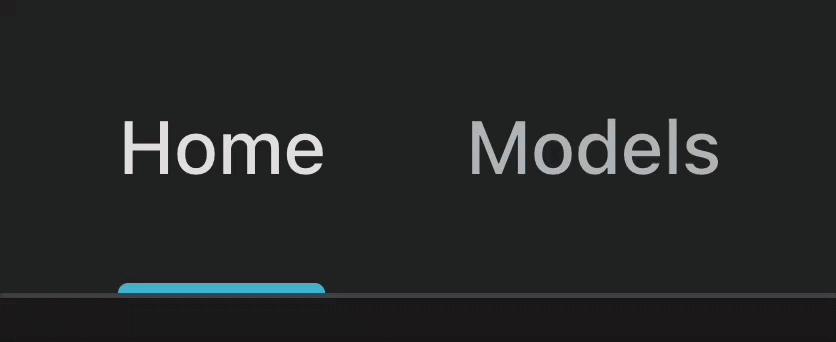
</div>

I do it by changing the animation of the `old` and `new` pseudo-elements instead of the group.
Because each of them animates something different. This is important to understand View Transitions.

| Pseudo-element            | What it animates                |
| :------------------------ | :------------------------------ |
| `::view-transition-group` | Transition of position and size |
| `::view-transition-old`   | Exit animation of old element   |
| `::view-transition-new`   | Enter animation of new element  |

Keep that in mind when you want to change enter and exit animations.

So for the disappearing, I use the `::view-transition-old` pseudo-element.
I set some animation to it. I can use CSS keyframes and change `scaleY`.

```css
::view-transition-old(tab-indicator) {
  animation: shrink 400ms;
}
/* dim-start */
@keyframes shrink {
  to { transform: scaleY(0) }
}
/* dim-end */
```

And I can use `new`. I can give it some `animation-delay`,
because I want the element to wait a few milliseconds before it shows up.

```css
::view-transition-new(tab-indicator) {
  animation: grow 400ms;
  animation-delay: 200ms;
}
/* dim-start */
@keyframes grow {
  from { transform: scaleY(0) }
}
/* dim-end */
```


<br/><br/><br/><br/>

<hr/>


## Beyond the fundamentals

A lot of tutorials end here.
But I think that if you want to use View Transitions on real projects,
it is good to know a few more things. You will definitely run into them in reality.


<br/><br/>

<hr/>


### 4. Real-world pitfalls

#### Lists of named elements

The first pitfall comes when you want to animate a list of elements.
Let's take the example from the beginning.
I open the card into the detail and then close it, so it lines up among the others again.

We already know from the tutorial that it takes three steps to implement View Transitions.
They are enabled already. So let's select the elements to transition.
I put the old state on one side and the new state on the other.
I want to animate the card and the detail.

<div className="grid grid-cols-2 gap-4 text-center [&_img]:rounded-xl">
<div>

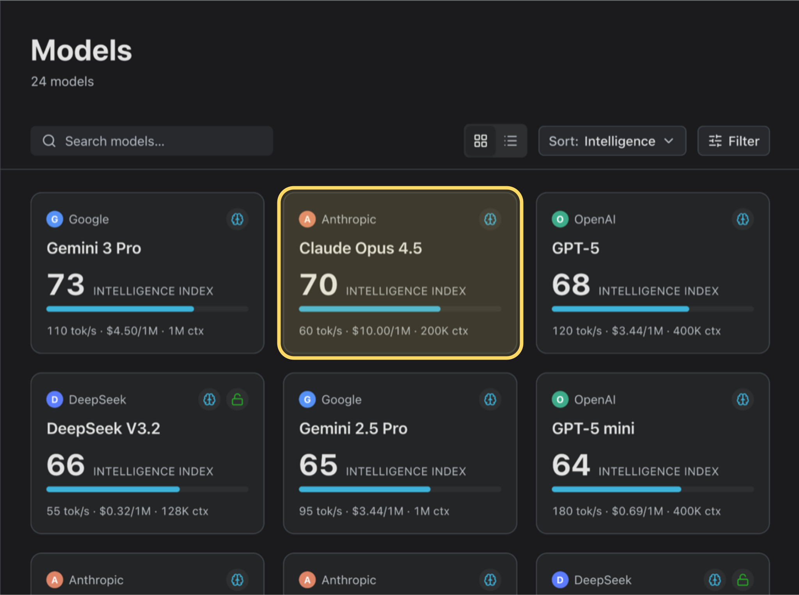

<span className="font-mono text-[#ffd966]">model-card</span><br/>BEFORE

</div>
<div>

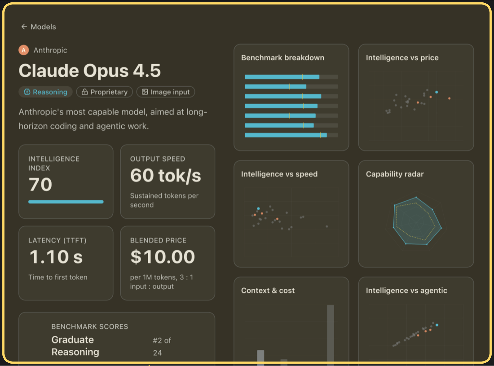

<span className="font-mono text-[#ffd966]">model-detail</span><br/>AFTER

</div>
</div>

I name the element. I give it the name `model`.

```css
.model-card, .model-detail {
  view-transition-name: model;
}
```

Super. That should work, right?
<mark class="error">Unexpected duplicate view-transition-name: model</mark>
It can't. The browser yells.

There are multiple cards on the BEFORE side.
And the view transition engine does not know which of them it should animate into the detail.

So that is the rule. <mark>A `view-transition-name` has to be unique on each side</mark>.
Before the change and also after the change.

The first idea is to add some ID.
You would probably generate it in JavaScript or on the server.
Either way, the result has to be a unique `view-transition-name`. In this case `model-opus45`.

Fine. But when I want to customize the animation in CSS, I refer to the `view-transition-name`.
So I would have to change the animation separately for Opus, separately for Gemini, and separately for all the others.

Instead, there is `view-transition-class`. Similar to an HTML class, it does not have to be unique.
It means I can put it on more of the cards.

```css
view-transition-name: model-opus45;
/* highlight-next-line */
view-transition-class: model;
```

And then I refer to it in CSS via `::view-transition-group` with the dot.
It is the same syntax as for styling classes. And I can for example change the `animation-duration`.

```css
::view-transition-group(.model) {
  animation-duration: 1000ms;
}
```

It is actually not recommended to target the view transition pseudo-elements by names in CSS.
Use names only to pair elements, and use classes only to target the pseudo-elements.
It means that in the fundamentals tutorial I did it the wrong way, for the sake of simplicity.

Now the card grows into the detail. The old and the new content crossfade on the way.

<div className="[&_img]:rounded-xl">
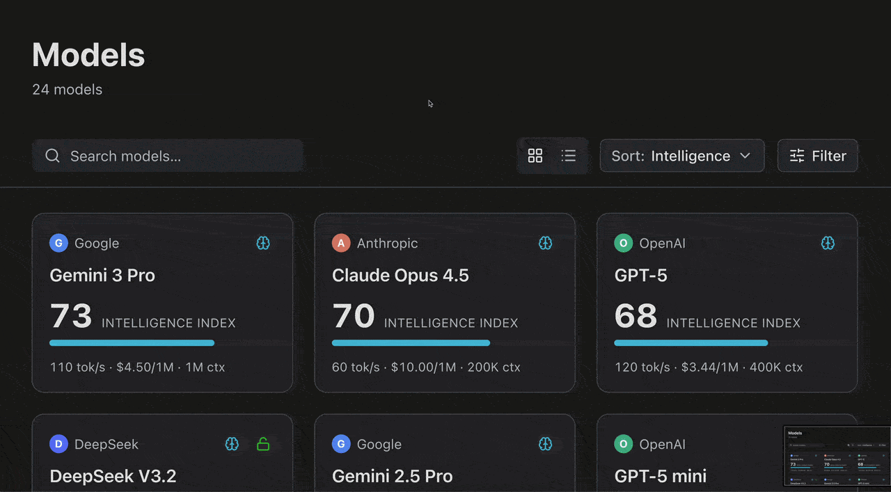
</div>

<br/>

#### Enter and exit transitions

The second pitfall is enter and exit animations.
We looked at them a bit already. But now I want to split the animation into phases.

With the crossfade, there is a moment in the middle of the animation
when different texts and a lot of information get mixed together. It does not look good.

<div className="grid grid-cols-2 gap-4 text-center [&_img]:rounded-xl">
<div>

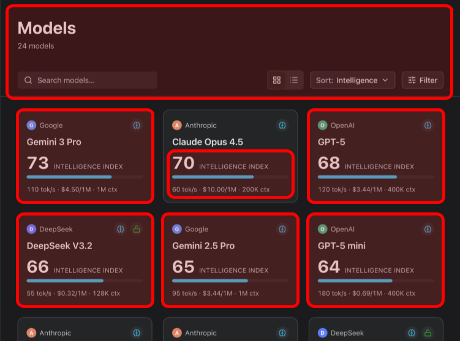

BEFORE

</div>
<div>

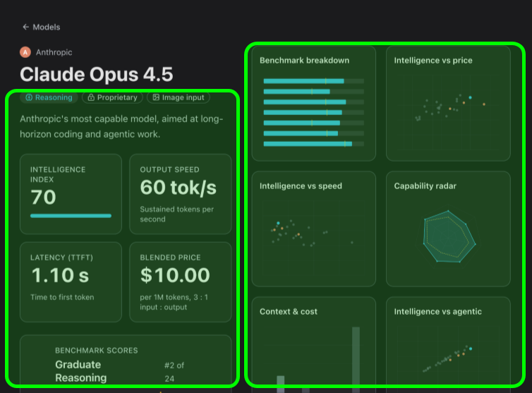

AFTER

</div>
</div>

So I want to quickly hide the <span className="underline decoration-[#ff0000] decoration-2 underline-offset-4">red parts</span> at the start, then do the card animation,
and only after a while show the new <span className="underline decoration-[#00ff00] decoration-2 underline-offset-4">green parts</span>.

Each of those elements needs its own `view-transition-name`.
Then I can create a `view-transition-class` called `fadeout`. Assign it to them.
And do `fadein` analogously.

```css
view-transition-name: ...;
/* highlight-next-line */
view-transition-class: fadeout;
```

And then use `::view-transition-old` together with the `:only-child` pseudo-class.

```css title="Exit transition"
/* highlight-next-line */
::view-transition-old(.fadeout):only-child {
  animation: fadeout 200ms;
}
```

By this I say: this animation targets only the elements which disappear
and do not have their paired counterpart on the other side. Just the red ones.

Why does it work? Because in the pseudo-element tree, there is only the `old` element in the group.
There is no `new` one. It has no counterpart on the other side.
So the `old` one is the only child of its parent. That is why `:only-child` works.

```html
▼ ::view-transition-group(model-gemini)
    ::view-transition-old(model-gemini)
```

Exactly the same goes for `new` and `:only-child`.
Notice I added an `animation-delay` of 500 ms. So I say: show me the new elements after a while.

```css title="Enter transition"
::view-transition-new(.fadein):only-child {
  animation: fadein 200ms;
  /* highlight-next-line */
  animation-delay: 500ms;
}
```

The last thing I want to add is to keep the title. That is easy now.
I give it a `view-transition-name`. Again, it has to be unique.
And a class, so I can customize the animation somehow.

```css
view-transition-name: title-opus45;
view-transition-class: title;
```

In the end I got what I wanted.
The elements hide, the card opens, the title is kept,
and after those 500 ms the rest of the information shows up.

<div className="[&_img]:rounded-xl">
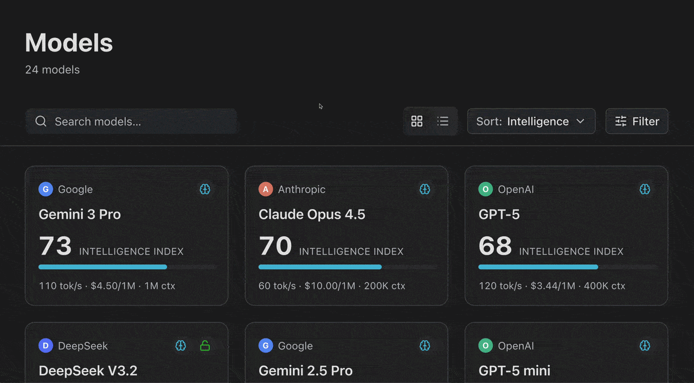
</div>

<br/>

#### Transition types

The last pitfall is to distinguish types of transitions.
What you hit very quickly with View Transitions is that animations start to show up in places where you do not intend them.
That is why it is important to scope the animations with types.

Let me go back to the animation between tabs. I switch between the Home tab and the Models tab.
And notice there are cards on the Home tab too. And the same ones are on the Models tab.
If I do nothing, the cards start to animate between each other.
Without me doing anything. Without me intending it.

<div className="[&_img]:rounded-xl">
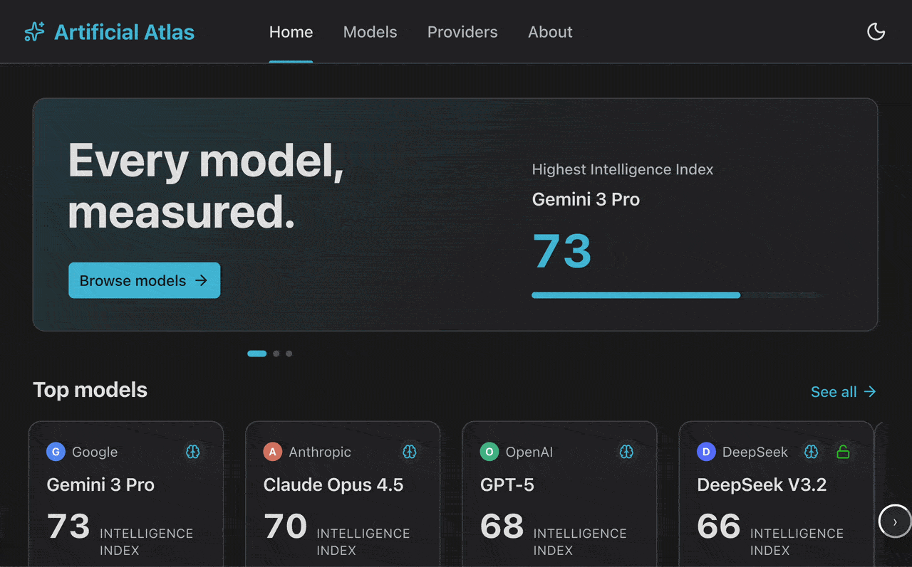
</div>

Maybe you like it. But my UX designer did not and wanted it removed.

What I actually want is to distinguish switching of tabs from opening and closing of the model detail.
Those are two types of animations.

<Quote variant="banner" className="mx-auto w-fit text-center">Tab switch <span className="text-[#ffd966]">≠</span> Model detail</Quote>

The setup differs between MPA and SPA.
I can set a type to the transition. In this case I say: this is switching of tabs. I pick the name `tab-switch`.
For the other one it could be `model-detail`.

```css title="MPA"
@view-transition {
  navigation: auto;
  /* highlight-next-line */
  types: tab-switch;
}
```

<div className="text-[color:var(--ifm-color-emphasis-400)]">

Advanced MPA note: This sets the type for every navigation from the page. To set it per navigation, add it in the `pageswap` or `pagereveal` event via `event.viewTransition.types`.

</div>

In the case of SPA, I add the type into the `startViewTransition` function.

```ts title="SPA"
document.startViewTransition({
  update: () => setPage("/home"),
  // highlight-next-line
  types: ["tab-switch"],
});
```

And then in CSS I can scope my animations with `:active-view-transition-type` and the name of the type.

```css
/* highlight-next-line */
html:active-view-transition-type(tab-switch) {
  &::view-transition-group(.model) {
    animation: none;
  }
}
```

These changes apply only to the type which is currently running.
So when I switch tabs, the cards are not animated between the pages anymore.


<br/><br/>

<hr/>


### 5. Practical tips

#### Browser DevTools

First of all, I definitely recommend turning on the Animations tab in your browser DevTools.
Not only can you slow the animation down from 100% to 25% or 10%, so you nicely see what is going on.
There is also this magic pause button.

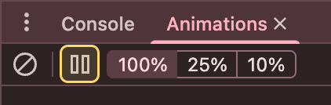

When you pause it and then click on a tab or on a card, it looks like nothing happens on the page.
Because the animation is frozen. Instead, a clear table like this shows up in the Animations tab.

<div className="[&_img]:rounded-xl">
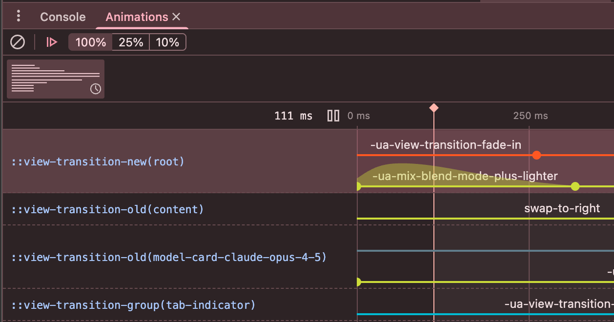
</div>

On the left side you see the pseudo-elements which are being animated. You can stop them.
And you can move the animation on the timeline right to the point you need to debug. The one you want to focus on.

<br/>

#### React `<ViewTransition>`

React 19.3 comes with a new stable component `<ViewTransition>`.
If you write React, definitely use this component. Do not use the low-level API I presented here.

Still, I think it is very important to know the low-level API at least a little.
Because when you debug in the browser, you see what is going on.
And I'm pretty sure when you read the [documentation](https://react.dev/reference/react/ViewTransition) of the `<ViewTransition>` component after this article,
you will understand it very quickly.
In the end it is just a thin wrapper over the browser API.
It uses `view-transition-name`, class, types. Everything we talked about here.

You use it roughly like this.

```tsx
<ViewTransition name="model">
  <ModelCard/>
</ViewTransition>
```

<br/>

#### z-index

And the last one. Sometimes the elements floating around the page overlap in a way you do not want.
Do not be afraid to use `z-index` on the `::view-transition-group` and order the animations on top of each other.

```css
::view-transition-group(.model) {
  z-index: 999;
}
```


<br/><br/><br/><br/>

<hr/>


## Conclusion

Now I would like you to imagine your project. A work one or a personal one.
And think about whether you see an opportunity somewhere in it.
A place where View Transitions would be pleasant for your users.
Where they would direct the user's attention, guide the user through your app, and help them with orientation.

I believe you now have everything you need to implement such an animation for your users.

So why not try it?

Thanks for reading.


import Gisqus from '@site/components/Gisqus';

<Gisqus/>
